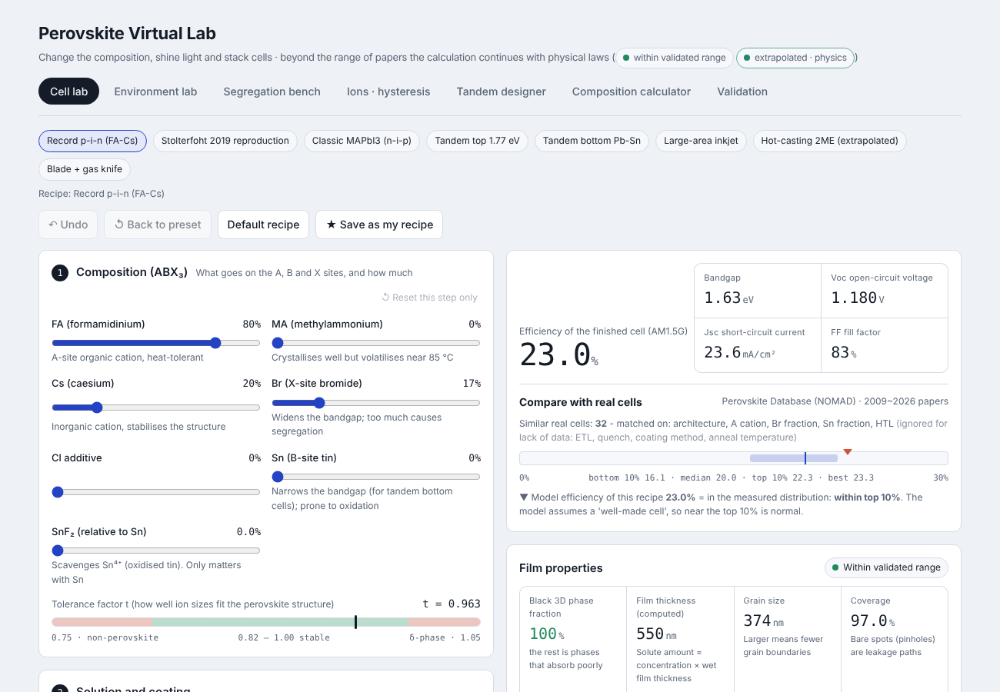
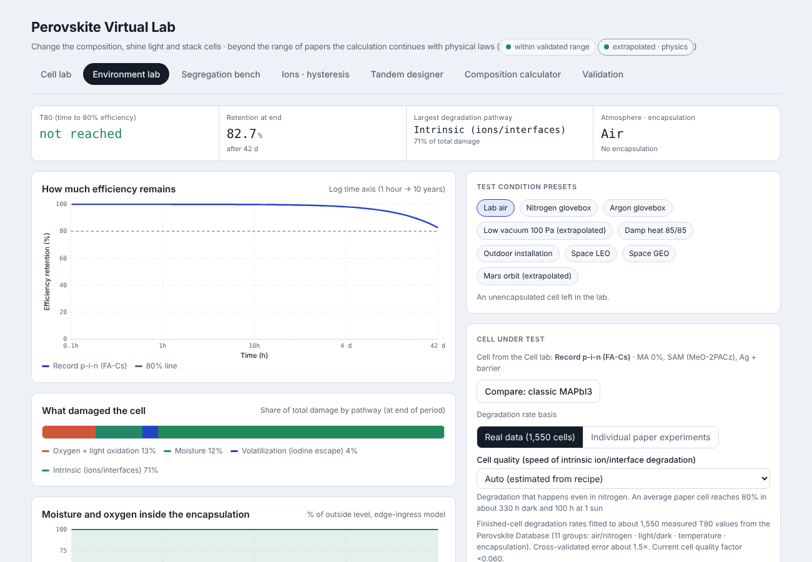

# perolab: a virtual lab for perovskite solar cells

**[Open the web lab](https://jiseong6i6-blip.github.io/perolab/)** · runs in any browser, nothing to install

perolab lets you "make" a perovskite solar cell on a computer. You pick the composition and the process, then age the cell in air, nitrogen or orbit, light-soak it and sweep its J-V curve. Most steps use published physics equations, with measured values from papers where the physics is too messy to derive, and the results are checked against papers and against **51,659 real cells** from the open Perovskite Database.

It is a learning and exploration tool, not a replacement for a lab. The [Limits](#limits) section is honest about where it is wrong.





## What's inside

Six benches plus a validation tab share one cell object. A cell you build in the fabrication bench can be carried into the other benches.

| Bench | What it does | Physics |
|---|---|---|
| Fabrication | composition (FA/MA/Cs, I/Br/Cl, Pb/Sn) → solvent, spin/blade coating, quench → anneal → atmosphere → transport layers → efficiency and a voltage-loss breakdown | Goldschmidt tolerance factor, Meyerhofer spin-coating thickness, LaMer + classical nucleation + diffusion-limited growth + JMAK coverage, LSW ripening, Clausius-Clapeyron solvent vapour pressure |
| Environment | air / dry air / N₂ / Ar / vacuum, encapsulation, temperature, humidity, light, LEO/GEO orbits → T80 lifetime and the dominant degradation pathway | Arrhenius pathways, Chapman-Enskog gas kinetics, Knudsen escape, orbital thermal balance |
| Phase segregation | light-induced I/Br demixing in mixed-halide films, PL peak shift, dark recovery | 2-D Cahn-Hilliard phase field |
| Ions & hysteresis | scan-rate dependent J-V hysteresis | 3-layer drift-diffusion (electrons, holes, halide vacancies, potential) after the IonMonger equations; runs in a Web Worker |
| Tandem designer | single, 2- and 3-junction stacks: efficiency vs band gap and non-radiative loss, current matching, temperature, AM1.5G vs AM0 | detailed balance with external radiative efficiency (ERE) per sub-cell |
| Composition | target band gap → required Br/Sn fractions | bowing models |

## Validation

| Check | Result |
|---|---|
| Core model vs literature (`validation/backtest.py`) | 20 / 20 |
| Fabrication, environment and ion benches vs papers (`validation/backtest_extended.py`) | 31 / 32 (one stability case honestly fails) |
| Physics sanity checks (vapour pressure, nucleation, gas kinetics…) | 38 / 38 |
| Recipe-effect contrasts vs Perovskite Database, same year and stratum | 28 / 31 (gas quench, CsFAMA and FA-Cs effects are off) |

Things the database **changed** in the model: no-quench coverage 0.78 → 0.88, a shunt-resistance floor, an extra Voc loss above 1.75 eV, and device-level degradation factors plus an intrinsic ion/interface channel fitted to about 1,550 measured T80 values with cross-validation. Details are in [`data/README.md`](data/README.md) and in the "Validation" tab of the web lab.

## Run it

The web lab is a single file: open `docs/index.html` in a browser.

Python (3.10 or newer):

```bash
python3 -m venv .venv && source .venv/bin/activate
pip install -r requirements.txt
python validation/backtest.py          # 20 checks, about 1 minute
python examples/07_fabrication_lab.py  # one example; outputs go to outputs/
./run_all.sh                           # all checks and examples 01–08, about 6–8 minutes
```

Rebuild the web lab after editing anything in `web/`:

```bash
python web/build.py   # writes web/index.html; copy it to docs/index.html to publish
```

Reproduce the database analysis: download the data (below) into `data/raw/`, then run the scripts listed in `data/README.md`.

## Repository layout

```
perolab/      Python package (materials, device, fabrication, environment, segregation, ionic)
examples/     nine runnable experiments
validation/   backtests against papers
data/         Perovskite Database analysis scripts and small result files
web/          web-lab sources (JS) and build script
docs/         built single-file web lab (served by GitHub Pages)
outputs/      figures and validation reports
```

## Limits

- Grain size, coverage and defect density come from simplified kinetics calibrated to a handful of papers. Treat absolute numbers as rough and relative trends as the useful part.
- Degradation is a sum of independent pathways. Real cells have coupled, recipe-specific chemistry, and an individual cell's T80 can only be predicted within about an order of magnitude.
- Three recipe effects disagree with the database (see Validation).
- The ion solver is a 1-D model with fixed parameters. It reproduces hysteresis trends, not a specific device.

## Data and credits

- Perovskite Database Project: T. J. Jacobsson *et al.*, "An open-access database and analysis tool for perovskite solar cells based on the FAIR data principles", *Nature Energy* **7**, 107–115 (2022), [doi:10.1038/s41560-021-00941-3](https://doi.org/10.1038/s41560-021-00941-3). Data archive: [doi:10.5281/zenodo.5834698](https://doi.org/10.5281/zenodo.5834698), CC BY 4.0. The latest version was pulled from NOMAD with `data/fetch_perovskite_db.py`. Raw CSVs are not included because of their size.
- Ion model equations follow IonMonger (N. E. Courtier *et al.*, *J. Comput. Electron.* 2019). This is an independent re-implementation in Python/JavaScript, and no IonMonger code is included.
- Solar spectra: ASTM G173 reference spectra (global AM1.5G and extraterrestrial AM0) via pvlib.

## How it was built

I designed the project, chose the physics and the validation targets, ran the database analysis and decided which model changes to keep. Most of the code was written together with an AI assistant (Claude). Every model change was checked against the backtests above before it was kept.

## License

Code: MIT (see `LICENSE`). Derived data files from the Perovskite Database remain CC BY 4.0 and must be credited as above.
